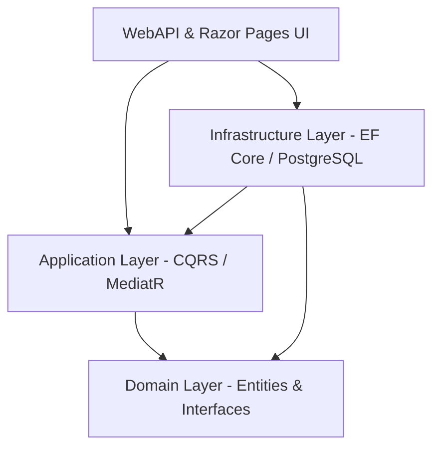

# CLJ — XML Auto Tagger & Legal Document Management Platform

[](https://dotnet.microsoft.com/)
[](https://learn.microsoft.com/en-us/dotnet/architecture/modern-web-apps-azure/common-web-application-architectures)
[](https://www.postgresql.org/)
[]()

**CLJ (XML Auto Tagger)** is an enterprise-grade platform designed for automated legal document intake, intelligent XML tagging, granular identity and access management, and multi-channel communication orchestration.

Built with **ASP.NET Core (.NET 9)**, **Entity Framework Core**, and **PostgreSQL**, following **Clean Architecture** and **CQRS (MediatR)** patterns.

---

## Table of Contents
- [Architecture Overview](#architecture-overview)
- [Key Features](#key-features)
- [Project Structure](#project-structure)
- [Technology Stack](#technology-stack)
- [Database & Auto-Seeding](#database--auto-seeding)
- [Getting Started](#getting-started)
  - [Prerequisites](#prerequisites)
  - [Configuration](#configuration)
  - [Running the Project](#running-the-project)
- [Default Seed Credentials](#default-seed-credentials)
- [API Documentation](#api-documentation)
- [Organization & Maintenance](#organization--maintenance)

---

## Architecture Overview

The solution adheres strictly to **Clean Architecture** (Onion Architecture) principles, enforcing separation of concerns and maintainability:



- **Domain Layer (`XMLAutoTagger.Domain`)**: Core enterprise business logic, entities, value objects, and domain enumerations. Free of external framework dependencies.
- **Application Layer (`XMLAutoTagger.Application`)**: Orchestrates business workflows using CQRS commands, queries, DTOs, and MediatR handlers.
- **Infrastructure Layer (`XMLAutoTagger.Infrastructure`)**: Manages external concerns: PostgreSQL persistence via EF Core, database auto-provisioning, JWT generation, and multi-channel communications.
- **Presentation Layer (`XMLAutoTagger.WebAPI`)**: Serves both RESTful API endpoints for headless consumption and interactive Razor Pages with a responsive UI.

---

## Key Features

### 1. Robust User & Department Management
- Hierarchical departmental structures with user-to-department assignments.
- Complete user lifecycle management (provisioning, status toggles, credential management).
- Audit trails tracking created/updated dates and author IDs.

### 2. Granular Role-Based Access Control (RBAC) & Screen Overrides
- Role-based screen access control (`View`, `Create`, `Edit`, `Delete`, `Admin`).
- **User Screen Overrides**: Fine-grained capability to grant or revoke specific permissions for an individual user without modifying global roles.

### 3. Unified Multi-Channel Communication Engine
- Single unified dispatch interface (`ICommunicationService`) supporting:
  - **Email** (SMTP, SendGrid, Amazon SES)
  - **SMS** (Twilio, Msg91, HTTP Gateways)
  - **WhatsApp** (Meta Cloud API, Twilio WhatsApp)
- Rule-based dynamic fallback mechanisms and priority overrides.

### 4. JWT & Security Infrastructure
- Stateless JWT-based authentication for APIs.
- Cookie/Bearer token authorization for Razor Pages UI.
- Secure password hashing and credential management.

### 5. Automated Database Provisioning & Seeding
- Zero manual SQL script requirement: EF Core automatically generates PostgreSQL schemas and tables on launch.
- Pre-seeds essential default departments, roles, screens, and administrative credentials.

---

## Project Structure

```plaintext
XMLAutoTagger/
├── XMLAutoTagger.Domain/                # Enterprise domain entities & core enums
│   ├── Common/                         # BaseEntity & audit metadata
│   ├── Entities/                       # User, Role, Department, Screen, Communication
│   ├── Enums/                          # AccountStatus, PermissionLevel, etc.
│   └── Interfaces/                     # IApplicationDbContext abstraction
│
├── XMLAutoTagger.Application/           # Business logic & use cases
│   ├── Common/                         # Models, interfaces, and exceptions
│   └── Features/                       # CQRS feature slices (Commands, Queries, DTOs)
│       ├── Departments/
│       ├── Profile/
│       ├── Roles/
│       ├── ScreenAccess/
│       └── Users/
│
├── XMLAutoTagger.Infrastructure/        # Data persistence & external services
│   ├── Persistence/                    # EF Core DbContext, Configurations, Migrations
│   │   ├── Configurations/             # Fluent API entity configurations
│   │   └── Extensions/                 # Pure HasData seed definitions
│   └── Services/                       # CommunicationService, JwtService, CurrentUserService
│
└── XMLAutoTagger.WebAPI/                # API controllers & Razor Pages presentation
    ├── Controllers/Api/                # Auth, Users, Roles, Departments, Communication APIs
    ├── Pages/                          # Razor Pages UI (Account, Users, Roles, Settings)
    ├── Services/ApiClients/            # Typed HTTP client abstractions
    └── appsettings.json                # Runtime configuration & connection strings
```

---

## Technology Stack

| Category | Technology |
| :--- | :--- |
| **Framework** | .NET 9.0 (ASP.NET Core) |
| **Language** | C# 13 |
| **Database** | PostgreSQL |
| **ORM** | Entity Framework Core 9 (Npgsql) |
| **Design Patterns** | Clean Architecture, CQRS, Repository/Unit of Work, Mediator |
| **Libraries** | MediatR, FluentValidation, BCrypt / ASP.NET Identity Hashing |
| **API Specs** | OpenAPI / Swagger |
| **Front-End** | Razor Pages, Modern Vanilla CSS, Fetch API |

---

## Database & Auto-Seeding

The project uses PostgreSQL with a dedicated schema (`user_mgmt`). On initial launch against a configured PostgreSQL instance:
1. `ApplicationDbContext` auto-generates tables if they do not exist (`Database.EnsureCreated()`).
2. Native EF Core deterministic data seeding inserts default roles, departments, system screens, and default administrative access.

---

## Getting Started

### Prerequisites
- [.NET 9.0 SDK](https://dotnet.microsoft.com/download/dotnet/9.0) or later
- [PostgreSQL 14+](https://www.postgresql.org/download/)

### Configuration
Update the database connection string and JWT settings in [appsettings.json](file:///d:/Personal/CLJ/XMLAutoTagger/XMLAutoTagger/XMLAutoTagger.WebAPI/appsettings.json):

```json
{
  "ConnectionStrings": {
    "DefaultConnection": "Host=localhost;Port=5432;Database=clj_xml_automation;Username=postgres;Password=your_password"
  },
  "Jwt": {
    "Key": "YourSuperSecretKeyThatIsAtLeast32CharactersLong!",
    "Issuer": "XmlAutoTaggerApi",
    "Audience": "XmlAutoTaggerClient"
  }
}
```

### Running the Project
1. Navigate to the solution directory:
   ```powershell
   cd d:\Personal\CLJ\XMLAutoTagger\XMLAutoTagger
   ```
2. Restore dependencies:
   ```powershell
   dotnet restore
   ```
3. Run the Web API:
   ```powershell
   dotnet run --project XMLAutoTagger.WebAPI
   ```
4. Access the application:
   - **Razor Pages UI**: `http://localhost:5079/` or `https://localhost:7079/`
   - **Swagger API Documentation**: `http://localhost:5079/swagger`

---

## Default Seed Credentials

Upon first launch, the auto-seeder provisions the default administrative account:
- **Email**: `admin@xmlautotagger.local`
- **Initial Password**: `Admin@123`
- **Role**: `Super Admin` (Full system access)

*(Please change the administrator password immediately upon first production deployment).*

---

## API Documentation

Interactive Swagger documentation is available out of the box in development mode:
- URL: `https://localhost:7079/swagger/index.html`
- Includes endpoints for:
  - `/api/auth` — Login, token issuance, and password management.
  - `/api/users` — User listing, creation, and status updates.
  - `/api/roles` — Role and permission configuration.
  - `/api/departments` — Departmental structuring.
  - `/api/screen-access` — Granular permission matrix and user overrides.
  - `/api/communication` — Multi-channel event dispatching.

---

## Organization & Maintenance

This repository is maintained under the **[Solver Thoughts Technologies Sdn Bhd](https://github.com/Solver-Thoughts-Technologies-Sdn-Bhd)** organization.

For issue reporting, feature requests, or contributions, please utilize GitHub Issues and Pull Requests within this repository.
